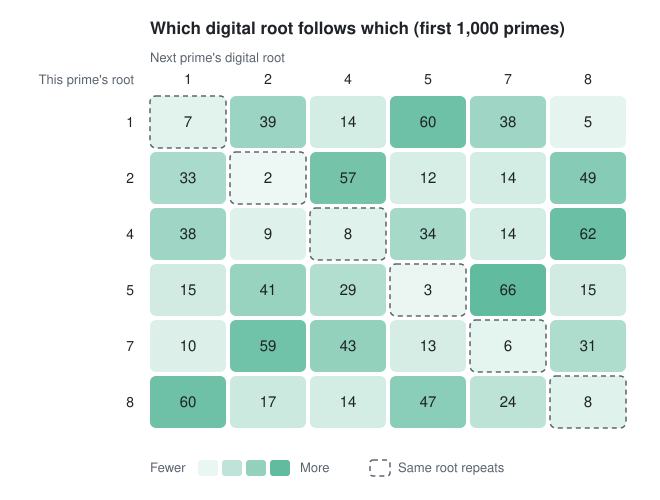

# digital-root-primes

Does the digital root of a prime tell you anything about the digital root of the next prime?

Short answer: yes, a little, and this repo measures how much and explains where it comes from.

Darker cells are more common. Three things show at a glance:

- **The dashed diagonal is pale.** A prime is rarely followed by one with the same digital root.
- **Each row has one darkest cell.** These are the smallest gap that root allows: a gap of 2 from roots 2, 5 and 8, and a gap of 4 from roots 1, 4 and 7 (a gap of 2 from those would land on a multiple of 3).
- **Each row has two more medium-dark cells.** One is a gap of 6, which every root allows. The other is the next gap that root allows: 10 from roots 1, 4 and 7, and 8 from roots 2, 5 and 8. In five of the six rows the gap of 6 is the more common; in the row for root 1 the two are level (38 and 39).

## What's here

| File | What it does |
|---|---|
| `modular_model_step9.py` | Builds a feature table for the first 1,000 primes (mod 9, digital root, gaps) and prints the root-to-root transition grid. |
| `experiment.py` | Trains sliding-window models to predict the next prime's digital root, with baselines and a control. |
| `heatmap.py` | Draws the transition grid as the colour heatmap above (`transition_heatmap.svg`). No extra packages needed. |
| `data/digital_root_prime_data/` | Every prime below 100,000 with its digital root, plus the frequency of each root. `experiment.py` re-checks this file against a fresh sieve. |

Run the experiment with `python experiment.py` (needs only NumPy; takes a few seconds). Redraw the picture with `python heatmap.py`.

## Result

Each model trains on the first 80% of primes in a range and is tested on the last 20%. Blind guessing among the six possible roots (1, 2, 4, 5, 7, 8) scores 16.7%.

| What the model sees | below 10^5 | below 10^6 | below 10^7 |
|---|---|---|---|
| Last 1 digital root | 30.3% | 26.7% | 25.2% |
| Last 3 digital roots | 28.8% | 26.7% | 25.6% |
| Current root + last 2 gaps | 27.0% | 27.0% | 26.0% |
| Current root + position on the mod-210 wheel | 42.5% | 36.2% | 33.3% |

The same models on the control sequence (fake primes, see below):

| What the model sees | below 10^5 | below 10^6 | below 10^7 |
|---|---|---|---|
| Last 1 digital root | 29.0% | 26.7% | 25.4% |
| Last 3 digital roots | 26.4% | 27.2% | 25.9% |
| Current root + last 2 gaps | 25.8% | 27.4% | 26.3% |
| Current root + position on the mod-210 wheel | 41.5% | 37.4% | 33.9% |

## What it means

1. **The signal is real.** One digital root predicts the next at 25 to 30%, well above the 16.7% of blind guessing.
2. **Almost all of it is in the most recent root.** Widening the window from 1 root to 3 or more adds at most a few tenths of a point, and long windows get worse because there is too little data per pattern.
3. **It fades as primes get larger.** 30% below 10^5 drops to 25% below 10^7.
4. **It is not specific to primes.** Random numbers that only avoid multiples of 2, 3, 5 and 7, and thin out at the rate primes do, score the same.
5. **Knowing the prime's position mod 210 beats any digital-root window**, on real and fake primes alike.

## Why

The next digital root is the current one plus the gap, mod 9. So predicting the next root is the same problem as predicting the next gap.

- A repeat of the same root needs a gap that is a multiple of 18. Small primes have small gaps (about 8 on average near 1,000), so repeats are rare. That is the pattern in the transition grid.
- As primes grow, gaps grow, larger gaps become common, and the pattern washes out. That is why accuracy falls with size.
- Gap sizes are set by density and by which small primes divide the neighbours. Fake primes share both, so they share the pattern. The mod-210 wheel encodes exactly that information, which is why it wins.

The bias in consecutive primes was documented by Lemke Oliver and Soundararajan, "Unexpected biases in the distribution of consecutive primes" (2016).

## Limits

- This predicts a residue class, not a location. Knowing the next root at 25% does not say where the next prime is.
- The control matches primes to within about a point, so nothing here shows structure beyond small-prime sieving and gap sizes. A finer effect could exist below what this test can resolve.
